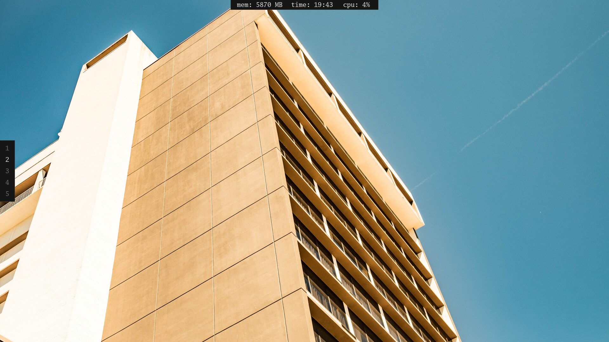
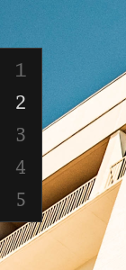
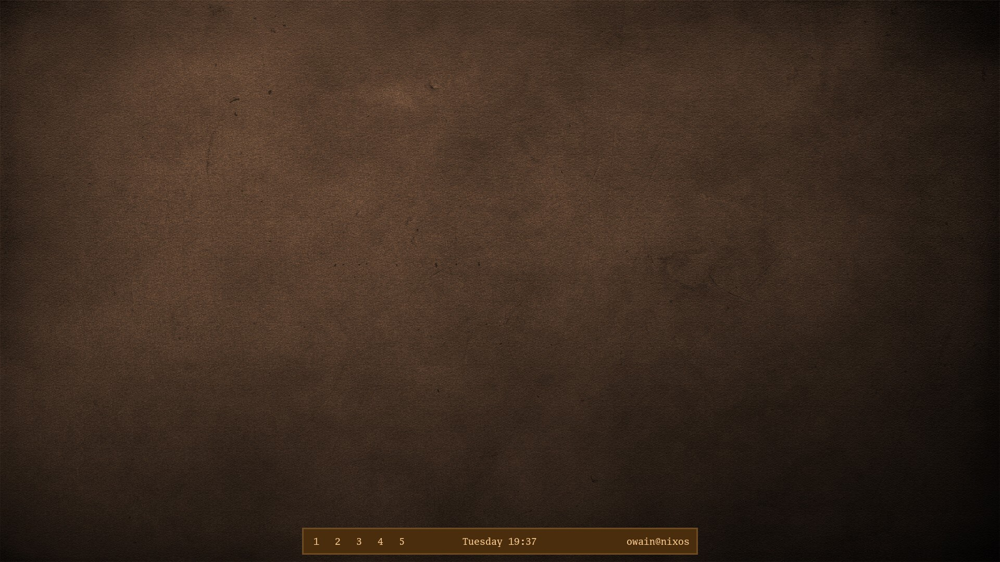

# waybar-config

My waybar config. v2 is the current one, v1 (the old bottom bar) is still in the v1 folder if you want it.



## v2

Two small bars instead of one big one, plain dark grey. Mem, time and cpu sit in a strip at the top middle, workspaces go down the left side. Both float over windows so they dont take up any space.




It works on hyprland, sway, niri, river, dwl and anything else that supports ext-workspace. The install script works out which one you are on. dwl needs the ipc patch for the workspaces to show.

## v1

The first one. One bar at the bottom with workspaces, the day and time and user@host, all brown.




## install

```
git clone https://github.com/owainxyz/waybar-config
cd waybar-config
./install.sh
```

That installs v2. For the old one run ./install.sh v1. If it guesses your compositor wrong you can tell it, like ./install.sh sway.

Your old config gets moved to ~/.config/waybar.bak.(time) first so nothing is lost.

Needs a recent waybar and Go Mono (GoMono Nerd Font) for the font, otherwise it falls back to whatever monospace you have.
